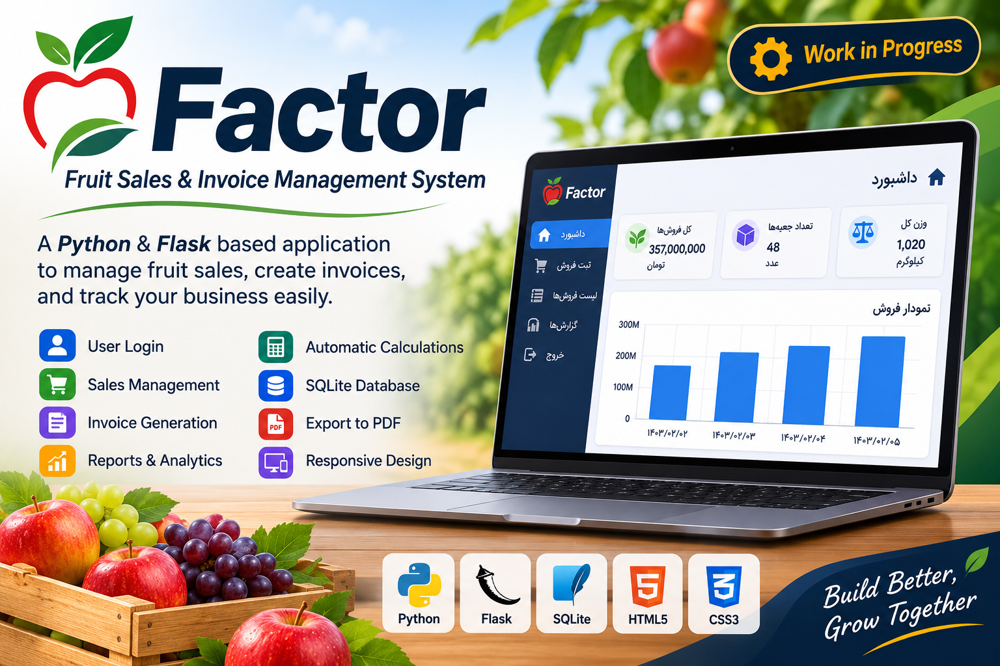

<div align="center">
  
</div>
# 🍎 Factor
### Fruit Sales & Invoice Management System

Factor is a personal Python project designed to simplify fruit sales management, invoice processing, and daily financial records.

The application is built with Flask and SQLite and currently runs locally.

> 🚧 **Project Status: Work in Progress**

## ✨ Features

- 🔐 User login system
- 🧾 Create and manage sales invoices
- 🍎 Record fruit types and quantities
- ⚖️ Calculate total sales automatically
- 💰 Calculate net received amounts
- 🏬 Store cold storage information
- 🚗 Save vehicle and driver information
- 📦 Track the number of boxes
- ✏️ Edit existing sales records
- 🗑️ Delete sales records
- 📅 Filter transactions by date
- 📄 Export sales records as PDF
- 🗄️ Store data using SQLite

## 🛠️ Tech Stack

| Technology | Purpose |
|---|---|
| Python | Backend programming |
| Flask | Web framework |
| SQLite | Database |
| HTML | Page structure |
| CSS | User interface |
| PDFKit | PDF generation |
| Git & GitHub | Version control |

## 📂 Project Structure

```text
factor/
│
├── static/
│   └── CSS and static assets
│
├── templates/
│   └── HTML templates
│
├── app.py
├── config.py
├── init_db.py
└── README.md
```

## ⚙️ Installation & Setup

### 1. Clone the repository

```bash
git clone https://github.com/AmirAzarinia/factor.git
cd factor
```

### 2. Create a virtual environment

```bash
python -m venv venv
```

Activate it on Windows:

```bash
venv\Scripts\activate
```

### 3. Install dependencies

```bash
pip install Flask pdfkit
```

PDF generation also requires `wkhtmltopdf` to be installed and configured on your system.

### 4. Initialize the database

```bash
python init_db.py
```

### 5. Run the application

```bash
python app.py
```

Open your browser:

```text
http://127.0.0.1:5000
```

## 🎯 Project Goals

- Improve sales and invoice management
- Simplify daily financial calculations
- Develop practical software using Python
- Improve backend development skills
- Continue improving the application architecture and security

## 🚀 Future Improvements

- Improved authentication and security
- Better database management
- Enhanced user interface
- Advanced sales reports
- Improved PDF generation
- Deployment and online accessibility

## 👨‍💻 Developer

**Amir Azarinia**

Python Developer | Software Development

[GitHub Profile](https://github.com/AmirAzarinia)

---

⭐ This project is actively being developed as a personal learning and software development project.
